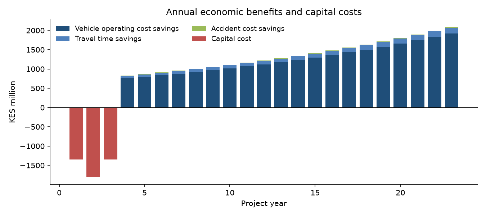
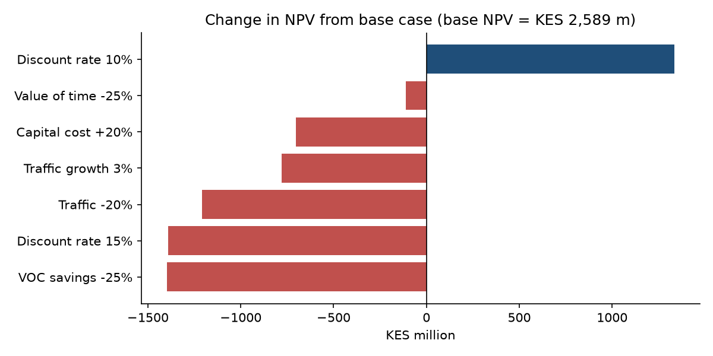
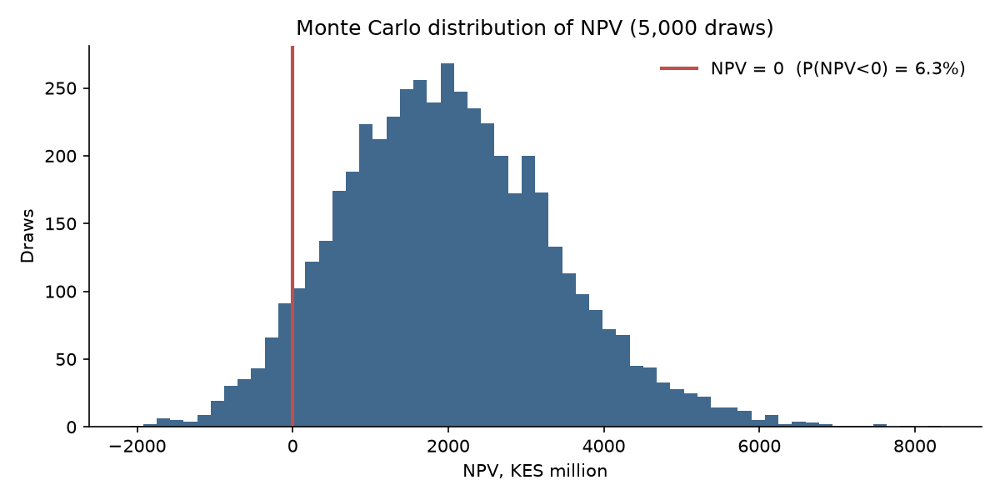

# Road Project Cost–Benefit Appraisal

A transparent, reproducible economic appraisal model for a road upgrade. It calculates NPV, EIRR, BCR and first-year return, then tests the result with sensitivity, switching-value and Monte Carlo risk analysis.

> **Illustrative case.** The project and every input are hypothetical assumptions chosen to be plausible for a Kenyan rural trunk road. They don't describe any real project or agency appraisal. The value of the repo is the method: swap in real traffic counts, cost estimates and unit savings to appraise an actual scheme.



## The case

The hypothetical scheme upgrades **50 km of gravel road to bitumen standard**:

- **Construction:** 3 years.
- **Appraisal period:** 20 years of operation.
- **Prices:** constant 2026 prices, economic costs net of taxes.
- **Discount rate:** 12%, a rate often used for transport appraisal in East Africa.

| Assumption | Base value |
|---|---|
| Capital cost | KES 90 m/km (KES 4.5 bn total), phased 30/40/30 |
| Opening-year traffic | 1,800 vehicles/day, growing 5% a year |
| Generated traffic | +10%, valued with the rule of half |
| Vehicle operating cost (VOC) saving | KES 22 per vehicle-km |
| Travel time saving | 0.35 h per trip at KES 250 per vehicle-hour |
| Accident cost savings | KES 6 m/yr, growing with traffic |
| Maintenance | KES 1.2 m/km/yr without the project, KES 0.5 m/km/yr with it, plus resurfacing every 8 years |
| Residual value | 25% of capital cost in the final year |

All assumptions live in one `Assumptions` dataclass in [`src/cba.py`](src/cba.py).

## Results

| Indicator | Base case |
|---|---|
| **NPV @ 12%** | **KES 2.59 bn** |
| **EIRR** | **19.3%** |
| **BCR** | **1.72** |
| FYRR | 19.1% |

The project is economically viable in the base case. Benefits are dominated by **vehicle operating cost savings**, so the appraisal depends most on traffic volumes and VOC estimates.

### Sensitivity



| Scenario | NPV (KES m) | EIRR |
|---|---|---|
| Capital cost +20% | 1,886 | 16.6% |
| Traffic −20% | 1,382 | 16.1% |
| VOC savings −25% | 1,191 | 15.6% |
| Discount rate 15% | 1,199 | 19.3% |

### Switching values

A switching value is the change in one input that would push NPV to zero, holding everything else at base:

- **Capital cost** would need to rise **74%**.
- **Opening-year traffic** would need to fall **43%**.
- **VOC savings per vehicle-km** would need to fall **46%**.

### Risk analysis



The Monte Carlo run uses 5,000 draws with uncertain capital cost (skewed towards overruns), traffic level, traffic growth, VOC savings and value of time. It gives:

- a **6.3% probability that NPV is negative**
- a median EIRR of **17.1%**

## Extending to a real appraisal

- Replace unit VOC savings with HDM-4 or RUC model outputs by vehicle class.
- Disaggregate traffic by vehicle type and use classified traffic counts.
- Add environmental (carbon) costs and wider economic benefits where the guidance allows them.

## Reproduce

```bash
pip install -r requirements.txt
python src/cba.py
```

Outputs are written to `results/` (cash flows, sensitivity, switching values, Monte Carlo summary) and `figures/`.

---
*Author: Denis Mburu, Economist and Statistician*
